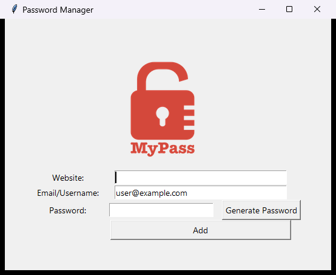
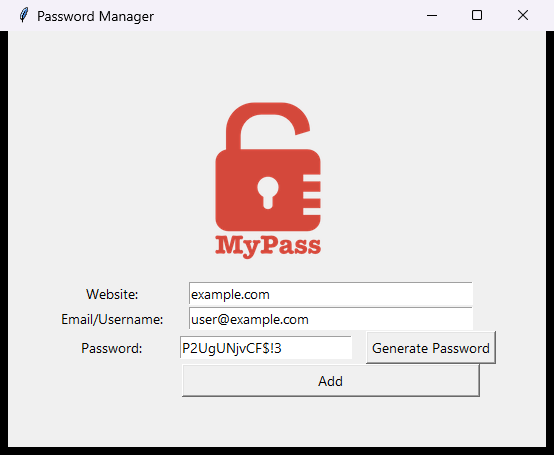

# MyPass

MyPass is a small desktop password manager written in Python with Tkinter, made
as Day 29 of Udemy's *100 Days of Code: The Complete Python Pro Bootcamp*. It
generates a strong random password (8 to 10 letters, 2 to 4 symbols and 2 to 4
digits), saves it with the website and email after you confirm, and copies it to
the clipboard. It has no runtime dependencies.




The wiki is available in [English][wiki], [Dansk][wiki-da] and [Bahasa Malaysia][wiki-ms].

## Requirements

- Python 3.13 or newer.
- Tkinter, the standard Python GUI toolkit. It is included with Python on
  Windows and macOS (python.org installer) and is the `python3-tk` package on Debian.
- Git, to clone the repository.
- Optional: Doxygen, to build the source documentation.

## Set up

Create a virtual environment named `.venv` in the project folder, activate it,
upgrade `pip` and install the project. Run the commands from the repository root.

### Windows powershell

```powershell
git clone https://git.tirsystem.com/Tirsvad-Udemy-100-days-of-code/029-password-manager.git
cd 029-password-manager
py -3.13 -m venv .venv
.\.venv\Scripts\Activate.ps1
python -m pip install --upgrade pip
python -m pip install -e ".[dev]"
```

If PowerShell refuses to run the activation script, allow it for this window
only with `Set-ExecutionPolicy -Scope Process -ExecutionPolicy RemoteSigned`.

### Linux debian

```bash
sudo apt install python3 python3-venv python3-tk git
git clone https://git.tirsystem.com/Tirsvad-Udemy-100-days-of-code/029-password-manager.git
cd 029-password-manager
python3 -m venv .venv
source .venv/bin/activate
python -m pip install --upgrade pip
python -m pip install -e ".[dev]"
```

### MacOS

```bash
git clone https://git.tirsystem.com/Tirsvad-Udemy-100-days-of-code/029-password-manager.git
cd 029-password-manager
python3 -m venv .venv
source .venv/bin/activate
python -m pip install --upgrade pip
python -m pip install -e ".[dev]"
```

`.[dev]` also installs the test and check tools. For only running the
application, `python -m pip install -e .` is enough. With Homebrew's Python, add
Tkinter with `brew install python-tk@3.13`.

## Run

With the virtual environment active:

```bash
python -m mypass
```

Without installing the project, from the repository root: `python src/main.py`.

Fill in the website, check the email, click **Generate Password**, then
**Add** and confirm. Each saved entry is one line `website | email | password`
in `data.txt` in the folder you started the program from. The file is plain text
and not encrypted, so do not use it for real passwords. `data.txt` is ignored by Git.

## Run the tests

```bash
python -m pytest
```

The tests of the logic need no display. The tests of the window are skipped when
no display is available.

## Continuous integration

The workflow [`.gitea/workflows/ci.yml`](.gitea/workflows/ci.yml) runs on every
push to `main` and every pull request. It installs the project with the `dev`
extra, checks formatting (`ruff format --check`), lint (`ruff check`), types
(`mypy --strict`), YAML (`yamllint`) and the workflow itself (`actionlint`, downloaded at a
pinned version and checksum), and runs `pytest` under a virtual display (`xvfb-run`), so the window tests run too.
It runs on a runner with the label `mypass-ci`, backed by an Ubuntu image pinned by
digest (`catthehacker/ubuntu`). The setup, the digest and the Tk and Xvfb versions are
recorded in the workflow header and `env`. To use another runner, change `runs-on`.
`.gitea/actionlint.yaml` declares the `mypass-ci` label for
[actionlint](https://github.com/rhysd/actionlint); with it installed locally,
`python -m pytest` runs the same check.

## Build the source documentation

The source uses Doxygen comments. With [Doxygen](https://www.doxygen.nl/)
installed:

```bash
doxygen Doxyfile
```

Open `docs/doxygen/html/index.html` afterwards. The output folder is ignored by Git.

## Project layout

```text
src/mypass/        the application: constants, password generator, storage, window
src/main.py        start script (python src/main.py)
tests/             pytest tests
docs/              project documents (business case, plan, milestones, reviews, ADR), images
wiki/              sources of the wiki in English, Danish and Bahasa Malaysia
.gitea/workflows/  continuous integration
pyproject.toml     project configuration
Doxyfile           Doxygen configuration
```

The project follows the planning-first process of the SQA and QC framework in
`framework/`; see [AGENTS.md](AGENTS.md), the [Business Case](docs/business-case.md)
and the [milestones](docs/milestones/).

## License

GNU Affero General Public License v3.0, see [LICENSE](LICENSE).

---

[wiki]: https://git.tirsystem.com/Tirsvad-Udemy-100-days-of-code/029-password-manager/wiki/Home
[wiki-da]: https://git.tirsystem.com/Tirsvad-Udemy-100-days-of-code/029-password-manager/wiki/Home.da
[wiki-ms]: https://git.tirsystem.com/Tirsvad-Udemy-100-days-of-code/029-password-manager/wiki/Home.ms
