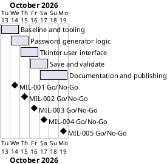

# Project Plan

## Metadata
| Key | Value |
| --- | --- |
| ID | PP-001 |
| CrossReference | [BC-001], [SA-001], [MIL-001], [MIL-002], [MIL-003], [MIL-004], [MIL-005], [US-001] |
| Language | en |
| Domain | it |

## Version History
| Date | Status | Author | Reviewer | Change | Commit |
| --- | --- | --- | --- | --- | --- |
| 2026-10-13 | Accepted | Jens Tirsvad Nielsen | S01 | Initial version | [b4c2611] |

---

## Purpose

Schedule the five gateways that deliver the MyPass password manager within the
one-week window of [BC-001], from the repository baseline to publication.

## Planning Assumptions

- Week 1 starts 2026-10-13; the plan ends by 2026-10-19.
- One gateway per one to two days; S01 owns and approves every gateway ([SA-001]).
- Autonomous mode: reviews are stand-in reviews by the AI and are recorded as such.
- Each gateway is one branch and one pull request that closes its issues.

## Gateway Schedule

| Gateway | Document | Window | Decision date | Owner | Stories | Main deliverable | Milestone |
| --- | --- | --- | --- | --- | --- | --- | --- |
| Baseline and tooling | [MIL-001] | 2026-10-13 to 2026-10-14 | 2026-10-14 | S01 | none (technical) | pyproject, layout, Doxyfile, CI, ADR | [Milestone 1][Milestone-1] |
| Password generator logic | [MIL-002] | 2026-10-14 to 2026-10-15 | 2026-10-15 | S01 | US-001.02 | `generate_password` and tests | [Milestone 2][Milestone-2] |
| Tkinter user interface | [MIL-003] | 2026-10-15 to 2026-10-16 | 2026-10-16 | S01 | US-001.01, .02, .03, .06 | runnable window with generation and clipboard | [Milestone 3][Milestone-3] |
| Save and validate | [MIL-004] | 2026-10-16 to 2026-10-17 | 2026-10-17 | S01 | US-001.04, .05, .06 | validated, confirmed saving to `data.txt` | [Milestone 4][Milestone-4] |
| Documentation and publishing | [MIL-005] | 2026-10-17 to 2026-10-19 | 2026-10-19 | S01 | US-001.07 | README, screenshots, 3-language wiki, repo metadata | [Milestone 5][Milestone-5] |



## Scope Coverage

| Business Case scope item | Gateway |
| --- | --- |
| MyPass application with the assignment's function names | [MIL-002], [MIL-003], [MIL-004] |
| Automated tests | [MIL-001], [MIL-002], [MIL-004] |
| pyproject.toml, constants.py, .gitignore, `.venv` instructions, Doxyfile | [MIL-001], [MIL-005] |
| README and three-language wiki with screenshots | [MIL-005] |
| Repository description and topics | [MIL-005] |

## Dependencies

```
MIL-001 → MIL-002 → MIL-003 → MIL-004 → MIL-005
```

A No-Go on a gateway moves every later date by the rework time; there is no slack
beyond the end date of 2026-10-19.

## Plan Risks

| Risk | Impact | Mitigation |
| --- | --- | --- |
| The Gitea wiki cannot be written through the API | Wiki not published | Wiki is a git repository (`<repo>.wiki.git`); push to it over SSH, and keep a copy in `docs/wiki/` |
| No display for screenshots in CI or on the machine | Missing screenshots | Capture on the development machine with the app running |
| Gitea token lacks permission to edit repository settings | Description and topics not set | Stop and report; S01 sets them in the web UI |

## Open Issues

- "Python greater than 3.13" is read as `>=3.13`; confirm if 3.14 or newer is meant.
- The wiki follows the page and language naming of the TirSystem github-action wiki (`Page`, `Page.da`, `Page.ms`); it was published through the Gitea wiki API.
- The host has no Gitea Actions runner (Gitea 1.27.3), so the CI workflow is written and statically tested but has not run; see the condition of RC-013.

---

[BC-001]: ./business-case.md
[SA-001]: ./stakeholder-analysis.md
[US-001]: ./user-stories.md
[MIL-001]: ./milestones/mil-001-baseline-and-tooling.md
[MIL-002]: ./milestones/mil-002-password-generator-logic.md
[MIL-003]: ./milestones/mil-003-tkinter-user-interface.md
[MIL-004]: ./milestones/mil-004-save-and-validate.md
[MIL-005]: ./milestones/mil-005-documentation-and-publishing.md
[b4c2611]: https://git.tirsystem.com/Tirsvad-Udemy-100-days-of-code/029-password-manager/commit/b4c26115f240097da76782a8e84a5367198226b5
[Milestone-1]: https://git.tirsystem.com/Tirsvad-Udemy-100-days-of-code/029-password-manager/milestone/147
[Milestone-2]: https://git.tirsystem.com/Tirsvad-Udemy-100-days-of-code/029-password-manager/milestone/148
[Milestone-3]: https://git.tirsystem.com/Tirsvad-Udemy-100-days-of-code/029-password-manager/milestone/149
[Milestone-4]: https://git.tirsystem.com/Tirsvad-Udemy-100-days-of-code/029-password-manager/milestone/150
[Milestone-5]: https://git.tirsystem.com/Tirsvad-Udemy-100-days-of-code/029-password-manager/milestone/151
