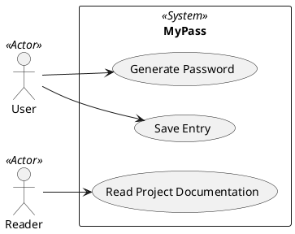

# Use Case Diagram

## Metadata
| Key | Value |
| --- | --- |
| ID | UCD-001 |
| CrossReference | [SA-001], [BC-001], [US-001] |
| Language | en |
| Domain | it |

## Version History
| Date | Status | Author | Reviewer | Change | Commit |
| --- | --- | --- | --- | --- | --- |
| 2026-10-13 | Accepted | Jens Tirsvad Nielsen | AI as stand-in for S01 | Initial version | [b4c2611] |

---

## Purpose and Scope

The boundary is the MyPass desktop application and its published project
material. Inside the boundary are the goals of the person using the password
manager and of the people who read and run the project. The git host and the
operating system's clipboard are outside the boundary.

## Diagram

## Actor Table

| Actor | Stereotype | Stakeholder ID (SA) | Goals (use cases) |
| --- | --- | --- | --- |
| User | `<<Actor>>` | S01 | Generate Password, Save Entry |
| Reader | `<<Actor>>` | S02, S03 | Read Project Documentation |

## Use Case Table

| Use Case | Actor(s) | Goal |
| --- | --- | --- |
| Generate Password | User | Get a strong random password in the form and on the clipboard (US-001.01, .02, .03, .06) |
| Save Entry | User | Store website, email and password after confirming them (US-001.04, .05, .06) |
| Read Project Documentation | Reader | Run the project and understand it in English, Danish or Bahasa Malaysia (US-001.07) |

## Relationships

| From | Relationship (`<<include>>` / `<<extend>>`) | To | Justification |
| --- | --- | --- | --- |
| none | none | none | The three goals are independent; no include or extend is needed |

---

[SA-001]: ./stakeholder-analysis.md
[BC-001]: ./business-case.md
[US-001]: ./user-stories.md
[b4c2611]: https://git.tirsystem.com/Tirsvad-Udemy-100-days-of-code/029-password-manager/commit/b4c26115f240097da76782a8e84a5367198226b5
